# 03 — Hasil POC

Semua hasil di bawah diambil dari 12 screenshot yang dilampirkan pembuat POC (22 Okt 2026, pukul 21:35–22:00 WIB). Indeks evidence lengkap: [../evidence/README.md](../evidence/README.md).

## 1. Lingkungan POC

| Komponen | Keterangan | Sumber |
|---|---|---|
| Portal Synology Drive | `https://naspoc.ogy.my.id/` | [POC] address bar |
| Panel DSM (Control Panel) | host `nas.ogy.my.id` pada address bar screenshot | [POC] |
| Akun | `admin` (**Deactivated**), `UserA`, `UserB` — semuanya 2FA **Disabled** | [POC] EV-01 |
| Grup | `Grup_DIVISI_A`, `Grup_DIVISI_B` (tanpa deskripsi) | [POC] EV-02 |
| Data uji | 4 file PNG di My Drive UserA, 4 file PNG di My Drive UserB (gambar dummy) | [POC] EV-03, EV-04 |
| Team Folder | Tidak diaktifkan sementara | [KETERANGAN POC] |
| Browser | UserA: Chrome profil biasa; UserB: Chrome mode Incognito (sesi terpisah) | [POC] |

> **Untuk dikonfirmasi:** pada screenshot, panel DSM berada di host `nas.ogy.my.id` sedangkan portal Drive di `naspoc.ogy.my.id`. Mohon dipastikan keduanya adalah NAS yang sama, dan didokumentasikan jalur akses POC (reverse proxy/tunnel/port-forward) agar desain produksi dapat meniru atau menyesuaikannya.

## 2. Ringkasan test case

| ID | Skenario | Hasil | Evidence |
|---|---|---|---|
| TC-01 | Struktur akun dan grup per divisi | Terdokumentasi | EV-01, EV-02 |
| TC-02 | My Drive terpisah per pengguna | Berhasil | EV-03, EV-04 |
| TC-03 | UserA membagikan folder ke UserB dengan 4 pilihan peran | Berhasil | EV-05 – EV-08 |
| TC-04 | UserB melihat isi yang dibagikan (Shared with me) | Berhasil | EV-09 |
| TC-05 | Berbagi arah sebaliknya (UserB → UserA) | Berhasil **[KETERANGAN POC]** — screenshot belum dilampirkan | — |
| TC-06 | Link publik untuk file: password + masa berlaku | Berhasil | EV-10 |
| TC-07 | Pengunjung publik membuka link (tanpa login) | Berhasil: mode Preview+Download dan mode Preview saja | EV-11, EV-12 |
| TC-08 | Pengunjung publik pada folder: rename/buat folder | **Tidak bisa** (batasan) **[KETERANGAN POC]** — screenshot belum dilampirkan | — |
| TC-09 | Team Folder | Belum diuji (ditunda) | — |

## 3. Rincian

### TC-01 — Akun dan grup (EV-01, EV-02)

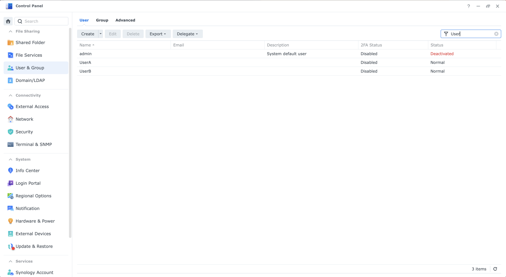

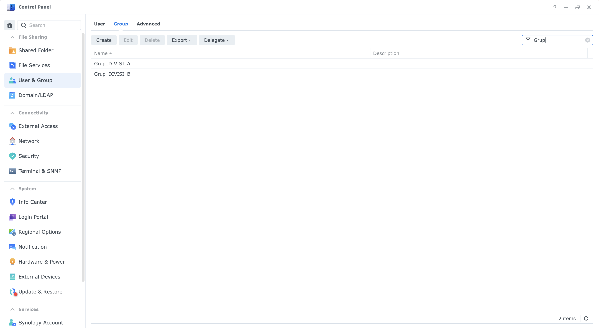

Pengamatan:

- Akun bawaan `admin` berstatus **Deactivated** — praktik baik (mengurangi risiko serangan pada akun default).
- `UserA` dan `UserB` berstatus Normal; **2FA Disabled** pada semuanya (wajar untuk POC; **tidak boleh dibawa ke produksi**, lihat [05](05-risiko-dan-mitigasi.md) R03).
- Dua grup per divisi sudah ada; kolom deskripsi kosong. Untuk produksi, beri deskripsi (pemilik grup, departemen, tanggal dibuat).

### TC-02 — My Drive per pengguna (EV-03, EV-04)

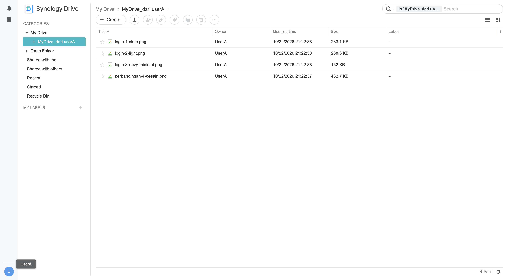

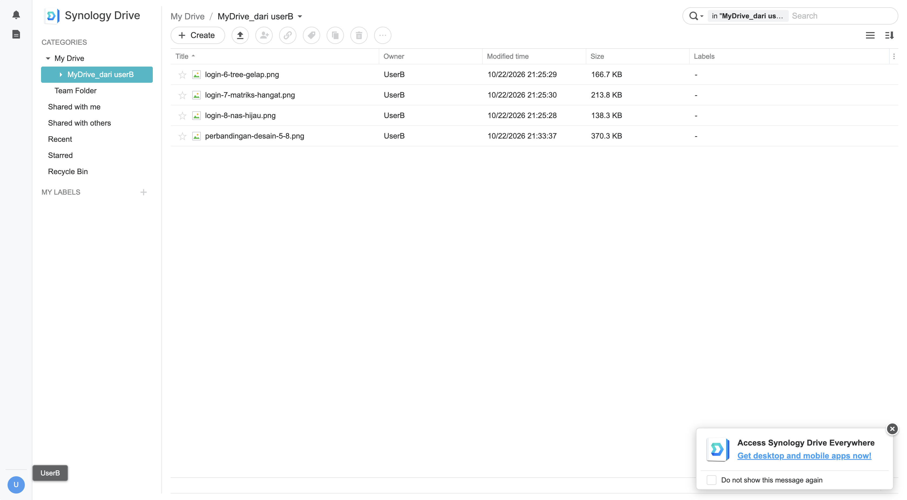

Pengamatan:

- Antarmuka mengikuti pola Google Drive: *My Drive, Team Folder, Shared with me, Shared with others, Recent, Starred, Recycle Bin, My Labels* **[POC]**.
- Masing-masing pengguna hanya melihat isi My Drive miliknya (UserA: `MyDrive_dari userA` — 4 file; UserB: `MyDrive_dari userB` — 4 file). Kolom *Owner* menunjukkan pemilik file.
- Pada screenshot UserA, *Team Folder* tampak memiliki panah perluasan, sedangkan pada UserB tidak. Perbedaan ini belum dijelaskan (mungkin karena fitur Team Folder belum aktif/akses berbeda) **[UJI]**.

### TC-03 — Berbagi folder dengan 4 peran (EV-05 s.d. EV-08)

Folder `MyDrive_dari userA` dibagikan dari UserA ke UserB. Dialog *Share* menampilkan *Directory Link* (tautan internal — hanya dapat dibuka oleh invitee), *Privacy Settings* **"Private – Only invitees can access"**, dan *Invitee list* yang menerima **User/Group** (jadi bisa langsung menunjuk grup divisi).

| Peran | Hak (tooltip pada UI) | Evidence |
|---|---|---|
| Previewer | Preview | EV-05 |
| Viewer | Preview, Download | EV-06 |
| Editor | Preview, Comment, Download, Upload, Edit | EV-07 |
| Manager | Preview, Comment, Download, Upload, Edit, Delete, Share | EV-08 |

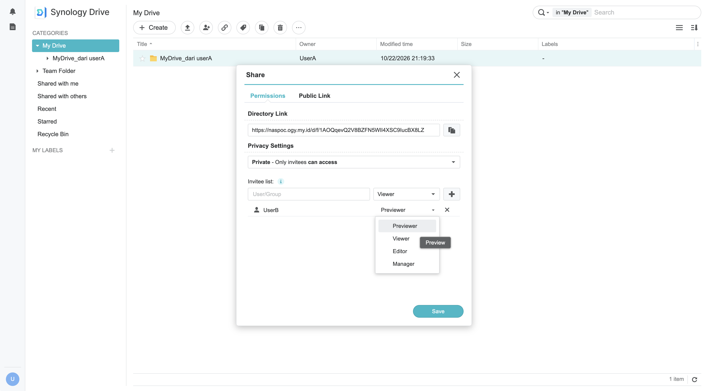

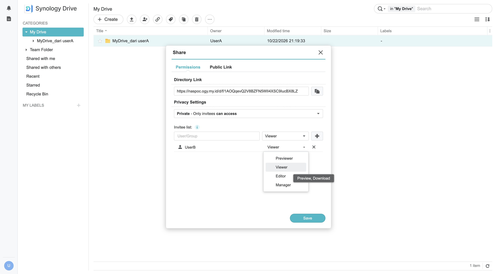

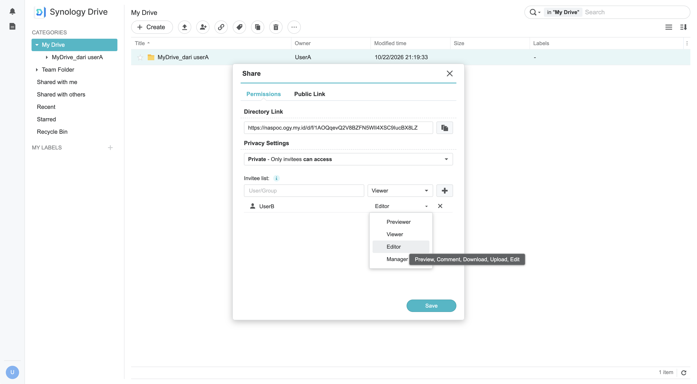

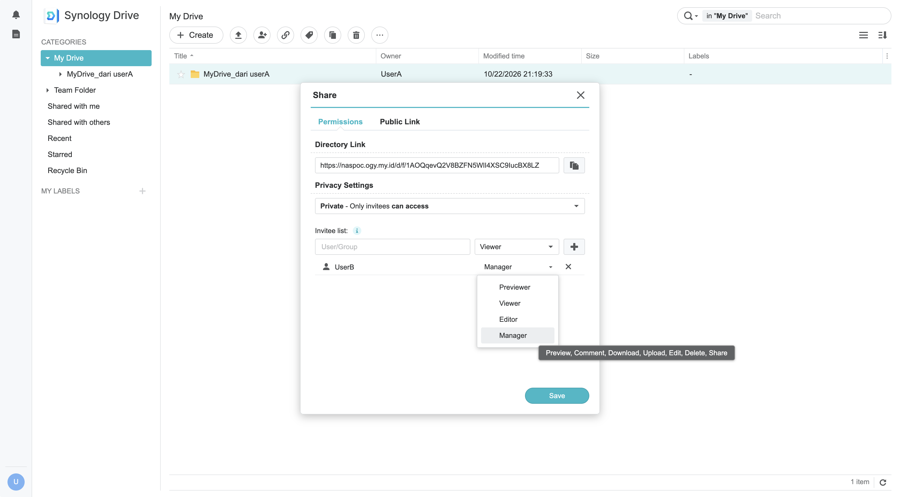

Pengamatan penting:

- Hanya **Manager** yang memiliki hak **Delete** dan **Share** (membagikan ulang). Peran ini sebaiknya dibatasi pada pemilik data.
- Peran **Viewer** dapat **mengunduh** — artinya data dapat keluar dari NAS. Jika dibutuhkan "lihat saja", gunakan **Previewer**.
- Folder dibagikan dengan mode *Private*: tidak ada akses tanpa login.

### TC-04 — Sisi penerima (EV-09)

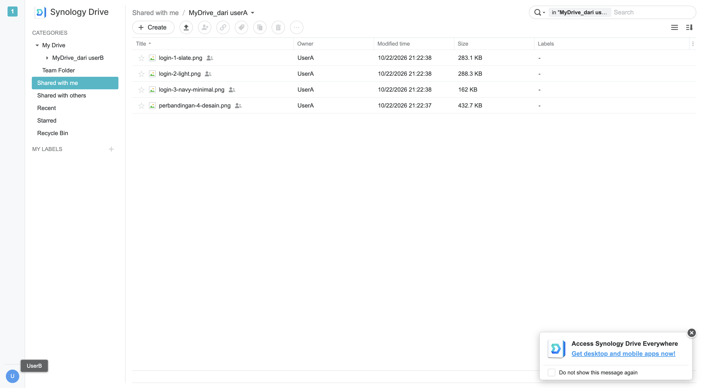

Pengamatan:

- UserB (sesi Incognito) melihat 4 file milik UserA pada *Shared with me → MyDrive_dari userA*; ikon "dibagikan" muncul di samping nama file, dan terdapat penanda notifikasi "1" pada sisi kiri atas.
- Tombol aksi seperti bagikan/hapus tampak nonaktif untuk UserB — konsisten dengan peran non-Manager. Peran yang disimpan saat screenshot diambil tidak terlihat; **[UJI]** ulangi dengan mencatat peran dan tombol yang aktif per peran.

### TC-05 — Arah sebaliknya (UserB → UserA)

Disampaikan berhasil oleh pembuat POC **[KETERANGAN POC]**. Mohon tambahkan screenshot *Shared with me* milik UserA agar evidence lengkap.

### TC-06 — Link publik dengan password dan masa berlaku (EV-10)

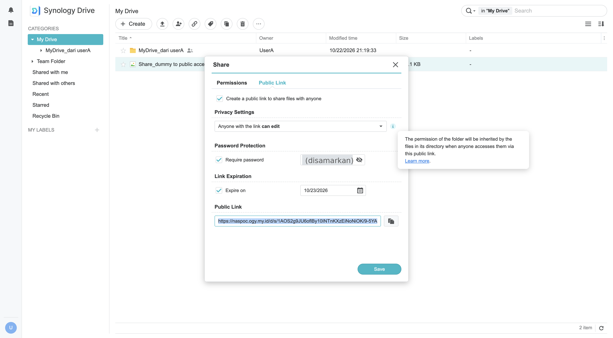

Pengamatan:

- Opsi *Create a public link to share files with anyone* menghasilkan URL berpola `/d/s/<token>` (berbeda dari *Directory Link* internal `/d/f/<token>`).
- Tersedia **Privacy Settings** (pada screenshot dipilih *"Anyone with the link can edit"*), **Password Protection** (nilai password disamarkan pada evidence ini), dan **Link Expiration** (pada screenshot: 23/10/2026, yaitu 1 hari).
- Tooltip UI: *izin folder diwariskan ke file di dalam direktori saat diakses lewat link publik*. Artinya membagikan **folder** lewat link publik berarti seluruh isinya terpapar dengan izin yang sama. Apakah file yang ditambahkan **setelah** link dibuat otomatis ikut terpapar belum diuji **[UJI]**.
- Password yang dipakai pada POC sangat lemah. Itu hanya contoh POC; untuk produksi perlu standar panjang/kerumitan dan penyampaian lewat kanal terpisah.

### TC-07 — Pengunjung publik (EV-11, EV-12)

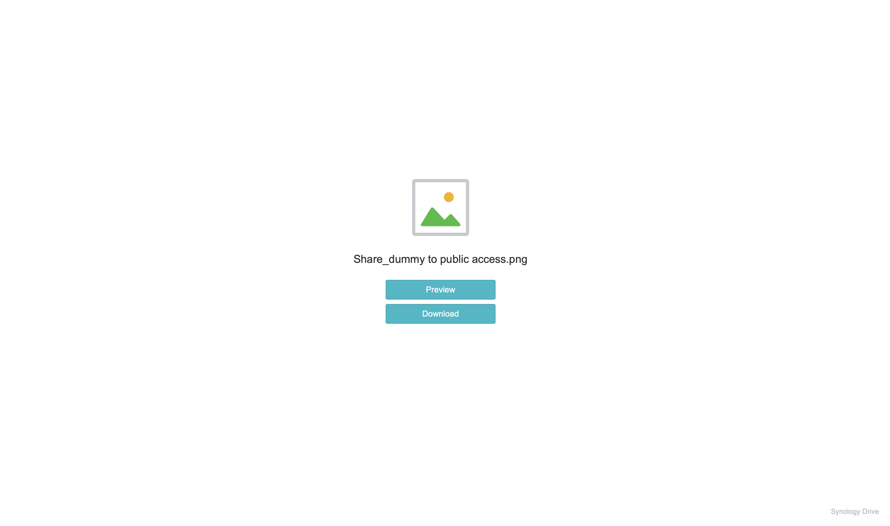

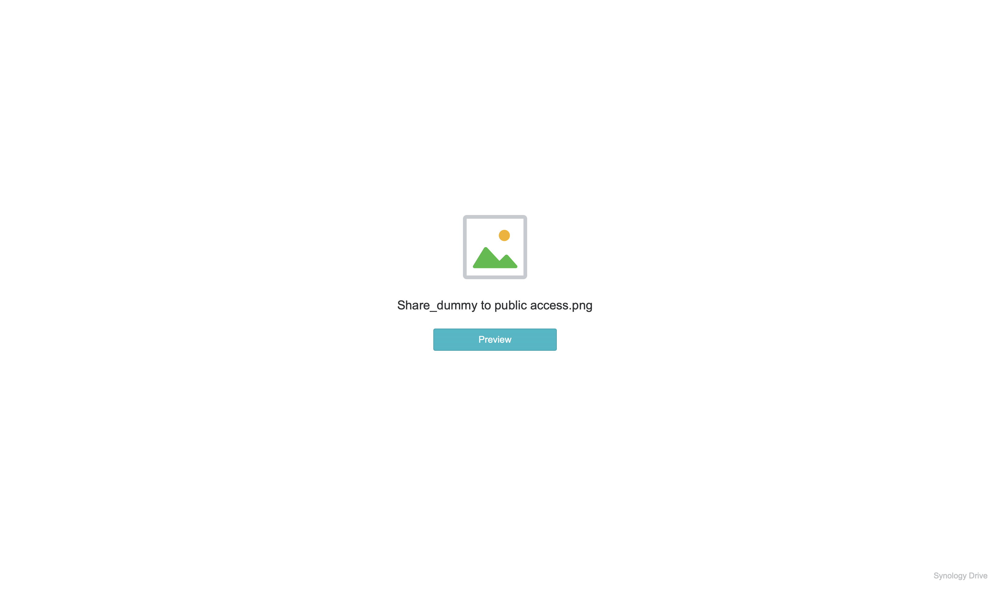

Pengamatan:

- Pengunjung tanpa login hanya melihat nama file dan tombol aksi. **EV-11:** *Preview* dan *Download*. **EV-12:** hanya *Preview*.
- Pengaturan yang menghasilkan masing-masing tampilan **tidak terlihat** pada screenshot. Mohon ditambahkan screenshot dialog untuk mode preview-saja agar jelas opsi mana yang dipakai.
- Tidak terlihat layar permintaan password pada evidence; untuk melengkapi, tambahkan screenshot layar password yang dilihat pengunjung **[UJI]**.

### TC-08 — Batasan folder publik

Menurut pembuat POC, pada akses publik pengunjung **tidak dapat mengganti nama atau membuat folder** **[KETERANGAN POC]**. Dari sisi keamanan ini justru menguntungkan (permukaan penyalahgunaan lebih kecil), tetapi dari sisi fungsi berbeda dari Google Drive "siapa pun dengan link dapat mengedit". Perlu screenshot dan dijelaskan kepada pengguna agar ekspektasi sejalan.

## 4. Temuan dan implikasi

| # | Temuan | Implikasi |
|---|---|---|
| T1 | Berbagi antar user (termasuk lintas divisi) berjalan native dengan 4 peran | Kebutuhan berbagi internal dapat dipenuhi tanpa Google Drive |
| T2 | Invitee dapat berupa **User/Group** | Berbagi per divisi cukup memakai grup yang sudah ada |
| T3 | Link publik mendukung password dan masa berlaku | Ada jalur resmi ke pihak luar yang bisa dikendalikan |
| T4 | Akses publik terbatas pada preview/unduh | Tidak 100% sama dengan Google Drive; lebih aman, perlu manajemen ekspektasi |
| T5 | Peran Viewer/Editor/Manager dapat mengunduh | Data tetap bisa keluar lewat unduhan; gunakan Previewer, watermark, dan pembatasan unduh per folder bila diperlukan [RESMI] |
| T6 | Link publik pada folder mewariskan izin ke isi folder | Hindari membagikan folder induk; bagikan file/folder khusus |
| T7 | Akun admin default dinonaktifkan; 2FA belum aktif | Pertahankan praktik admin dinonaktifkan; wajibkan 2FA di produksi |
| T8 | Jalur akses publik POC belum terdokumentasi | Perlu desain publikasi eksternal (FortiGate) sebelum produksi |

## 5. Keterbatasan POC

- Satu lingkungan pribadi, dua akun, data dummy, tanpa beban nyata.
- Tidak menguji Team Folder, kuota, versioning, recycle bin, backup/restore, klien desktop/mobile, dan log.
- Evidence untuk TC-05 dan TC-08 belum ada. Daftar uji lanjutan: [../riset-synology-drive/06-uji-lanjutan-dan-pertanyaan-terbuka.md](../riset-synology-drive/06-uji-lanjutan-dan-pertanyaan-terbuka.md).
